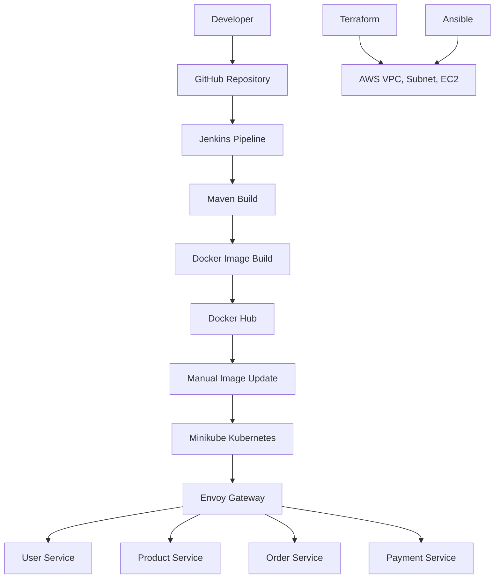
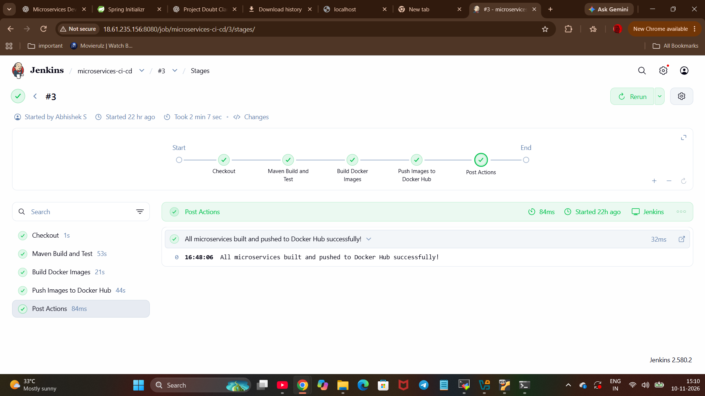
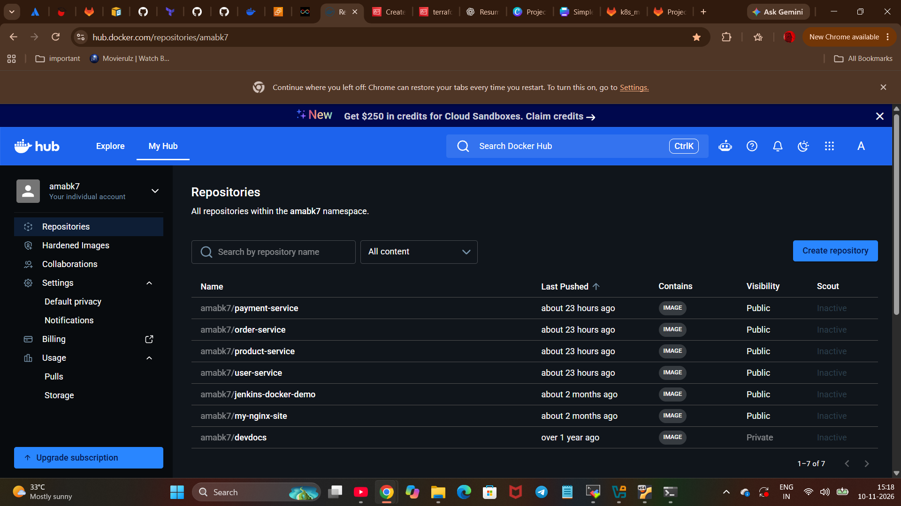
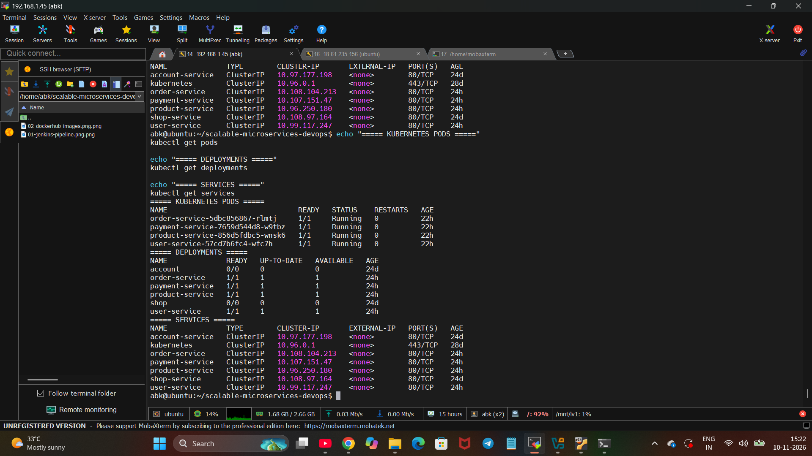
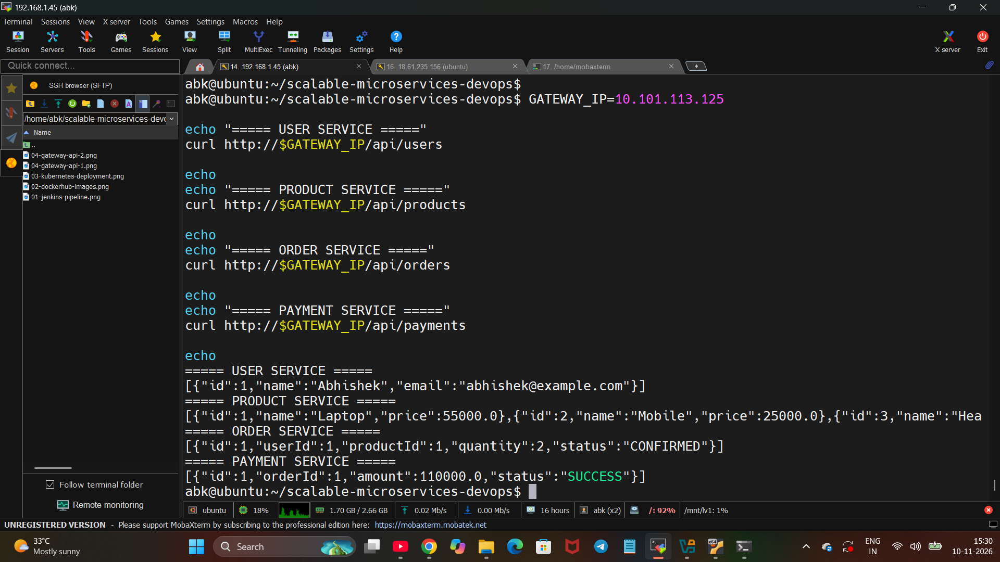
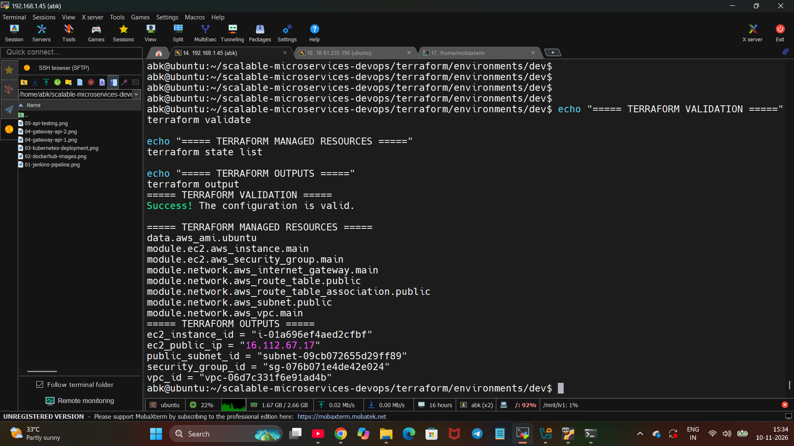
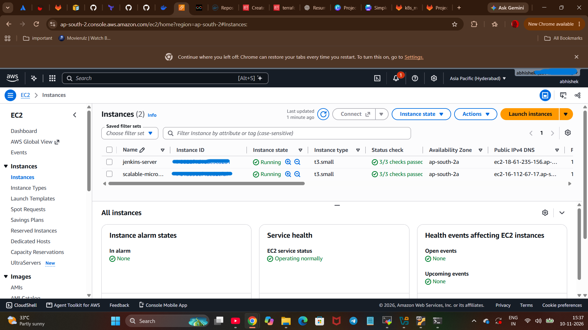
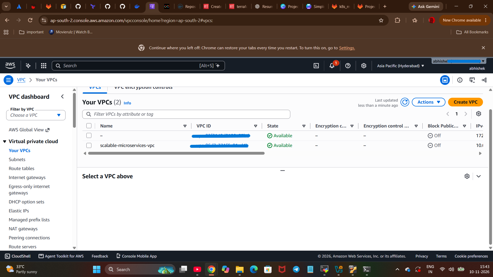
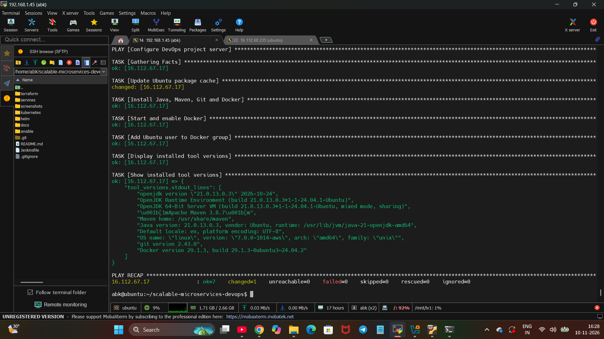

# scalable-microservices-devops
Designed and implemented a scalable microservices-based application using DevOps practices, Kubernetes, CI/CD pipelines, and Infrastructure as Code to automate deployments, ensure infrastructure consistency, and improve application reliability, scalability, and maintainability.


# Scalable Microservices Architecture Using DevOps Practices

A Java Spring Boot microservices application demonstrating containerization, CI/CD automation, Kubernetes orchestration, Infrastructure as Code, and configuration management.

## 1. Project Overview

This project demonstrates the transformation of an application into four independently deployable microservices, supported by a DevOps workflow.

The implementation uses GitHub for source control, Jenkins for CI automation, Docker Hub for container images, Kubernetes for orchestration, Terraform for AWS infrastructure provisioning, and Ansible for server configuration.

## 2. Architecture



## 3. Microservices

| Service | Port | Responsibility |
|---|---:|---|
| User Service | 8081 | User information |
| Product Service | 8082 | Product catalogue |
| Order Service | 8083 | Order management |
| Payment Service | 8084 | Simulated payment processing |

Each service is developed using Java 17 and Spring Boot, with Maven managing the build.

The current application uses in-memory sample data. Persistent databases are not configured.

## 4. Technology Stack

| Technology | Purpose |
|---|---|
| Java 17 / Spring Boot | Microservices development |
| Maven | Build and dependency management |
| Git / GitHub | Source control |
| Jenkins | CI pipeline automation |
| Docker | Containerization |
| Docker Hub | Container image registry |
| Kubernetes / Minikube | Container orchestration |
| Gateway API / Envoy Gateway | External application routing |
| Terraform | AWS infrastructure provisioning |
| Ansible | Server configuration management |
| Ubuntu Linux | Development and server environment |

## 5. CI Pipeline

The Jenkins pipeline performs:

1. Checkout source code from GitHub.
2. Build all four services using Maven.
3. Build Docker images.
4. Authenticate with Docker Hub using Jenkins credentials.
5. Push versioned and latest images to Docker Hub.

Docker Hub repositories:

- `amabk7/user-service`
- `amabk7/product-service`
- `amabk7/order-service`
- `amabk7/payment-service`

The Kubernetes image update is currently performed manually after a successful image push. Jenkins does not directly deploy to Minikube.

## 6. Kubernetes Deployment

The four microservices are deployed using Kubernetes Deployments and ClusterIP Services.

Envoy Gateway provides one external entry point and routes requests based on URL paths.

| API path | Destination |
|---|---|
| `/api/users` | User Service |
| `/api/products` | Product Service |
| `/api/orders` | Order Service |
| `/api/payments` | Payment Service |

Example requests:

```bash
curl http://GATEWAY_IP/api/users
curl http://GATEWAY_IP/api/products
curl http://GATEWAY_IP/api/orders
curl http://GATEWAY_IP/api/payments
```

Replace `GATEWAY_IP` with the current Envoy Gateway external IP.

## 7. Terraform Infrastructure

Terraform provisions the following AWS resources:

- VPC
- Public subnet
- Internet Gateway
- Public route table and association
- Security group
- Ubuntu EC2 instance

Reusable modules are maintained under:

```text
terraform/
├── environments/
│   └── dev/
└── modules/
    ├── ec2/
    └── network/
```

The development environment uses AWS region `ap-south-2`.

## 8. Ansible Configuration

Ansible configures the Terraform-created Ubuntu EC2 instance.

The playbook installs:

- OpenJDK 21
- Maven
- Git
- Docker

It also enables Docker and adds the Ubuntu user to the Docker group.

Run:

```bash
ansible-playbook \
  -i ansible/inventory/hosts.ini \
  ansible/playbooks/configure-server.yml
```

Create your own inventory using `ansible/inventory/hosts.ini.example`. Keep private keys and actual inventory details out of GitHub.

## 9. Repository Structure

```text
scalable-microservices-devops/
├── ansible/
│   ├── inventory/
│   └── playbooks/
├── docs/
│   ├── architecture.md
│   ├── project-plan.md
│   └── demo-guide.md
├── kubernetes/
│   ├── gateway/
│   └── microservices.yaml
├── services/
│   ├── user-service/
│   ├── product-service/
│   ├── order-service/
│   └── payment-service/
├── terraform/
│   ├── environments/
│   └── modules/
├── helm/
├── Jenkinsfile
└── README.md
```

## 10. Important Implementation Notes

- GitHub is used instead of the GitLab integration originally described in the project brief.
- Docker Hub is used as the container registry.
- Minikube is used for Kubernetes deployment instead of Amazon EKS.
- Jenkins automates build, containerization, and image publishing. Kubernetes deployment is a separate manual step.
- Payment processing is simulated.
- Application data is stored in memory; databases are not configured.
- Terraform provisions a demonstration AWS environment. The infrastructure should be destroyed after project validation to avoid ongoing charges.

## 11. Cleanup

From the Terraform development directory:

```bash
terraform destroy
```

Review the proposed deletions and confirm when ready.

The Jenkins EC2 instance is separate from the Terraform-managed infrastructure and must be stopped or terminated separately if it is no longer required.

## 12. Project Repository

GitHub: https://github.com/Abhisheksurendran/scalable-microservices-devops


## 13. Project Demonstration and Screenshots

The following screenshots demonstrate the implemented DevOps workflow.

### 1. Jenkins CI Pipeline


### 2. Docker Hub – Microservice Images


### 3. Kubernetes Deployments


### 4. Envoy Gateway API


### 5. Microservices API Testing


### 6. Terraform Infrastructure Provisioning


### 7. AWS EC2 Instance


### 8. AWS VPC Infrastructure


### 9. Ansible Configuration Management

